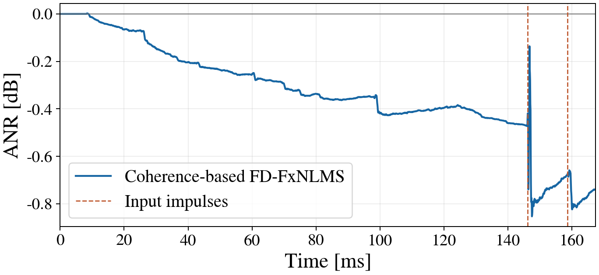

# APSIPA ASC 2026

Code accompanying Yosuke Sugiura, “Coherence-Based Variable Step-Size FD-FxNLMS for Active Impulsive Noise Control,” APSIPA ASC 2026.

- `algorithms_20260815.py` contains the coherence-based FD-FxNLMS class extracted from the August 15 implementation snapshot.
- `make_anc_figure.py` uses `baseline_inputs.npz` to generate the 30 ms illustrative waveform and spectrum comparison. The archived input was obtained from a seeded simulation with symmetric alpha-stable noise (alpha = 1.45). The comparison amplifies one impulse and inserts a second equal-amplitude impulse of the same sign.

From the repository root, run:

```sh
python -m pip install -r apsipa2026/requirements.txt
python apsipa2026/make_anc_figure.py
```

The script saves the waveform and spectrum comparison in PDF and PNG and the ANR curve as `apsipa2026/figures/anr.png`.

## Example ANR output



The curve shows the default short simulation with symmetric alpha-stable noise (alpha = 1.45) and the two marked impulses. ANR uses the smoothed amplitude ratio in Eqs. (30) and (31), with a smoothing coefficient of 0.999. The exact paper experiment configuration, the settings for all compared algorithms, and reproduction of the reported ANR and RTF remain unverified.
